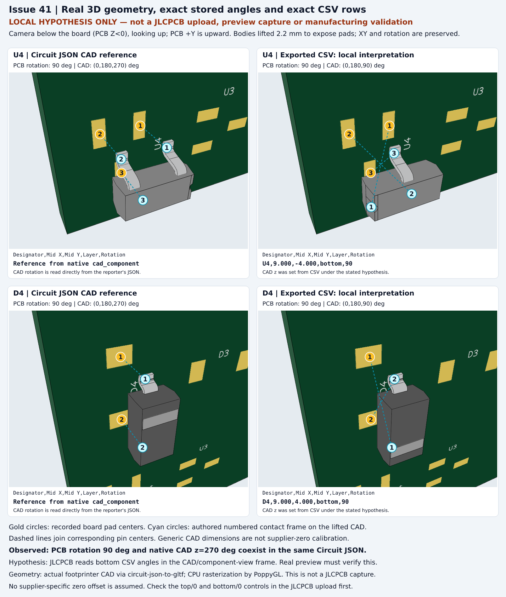
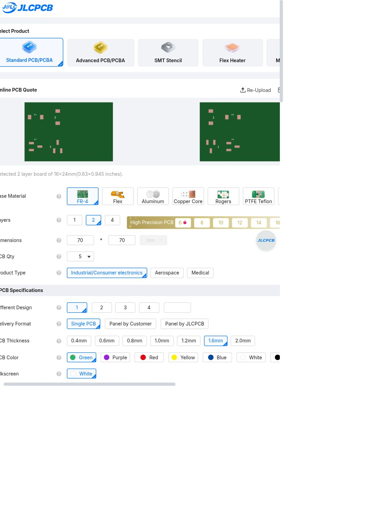

# Issue 41: bottom-side placement investigation

**The local reconstruction is not evidence of JLCPCB's actual CSV interpretation. Do not merge a default rotation change based on these images alone.**

The reported board contains two separate angle records for U4 and D4:

| Record | Actual saved value | Meaning in this reproduction |
| --- | --- | --- |
| `pcb_component.rotation` | `90` | Authored PCB placement angle |
| `cad_component.rotation` | `{ x: 0, y: 180, z: 270 }` | Native 3D model's Euler transform |
| Main CPL row | `bottom,90` | Existing converter output |
| Candidate CPL row | `bottom,270` | Proposed component-view interpretation |

Different angle numbers can describe the same physical pose in different coordinate frames. The native CAD transform is observed in the recorded JSON. Whether JLCPCB interprets a CPL angle in that same component-view frame is the unverified hypothesis.

## Actual 3D regression image



The renderer uses `circuit-json-to-gltf@0.0.151` and `poppygl@0.0.37`, not a drawn imitation of a 3D viewer. The left column reads the original `cad_component` transform. The right column substitutes the exact exported CSV rotation into CAD z **under the explicit local hypothesis**. All columns share the same camera below the PCB, looking toward it. Components are lifted 2.2 mm to expose the pads; their XY placement is preserved. Gold numbered markers identify recorded board pad centers. Cyan markers use the authored footprint's numbered contact frame; generic CAD body dimensions are not supplier-zero calibration.

Both exact CSV rows and the PCB/CAD angles appear in the image. The reference CAD records and silkscreen were copied from the reporter's original issue attachment without changing their values.

Regenerate the snapshot on either PR branch:

```sh
bun install --frozen-lockfile
BUN_UPDATE_SNAPSHOTS=1 bun test tests/bottom-side-rotation-3d.test.ts
```

Run without `BUN_UPDATE_SNAPSHOTS` to compare the actual 3D render against the stored snapshot. The test also checks that conversion/rendering preserve the input JSON. The source renderer is in `tests/fixtures/render-bottom-side-rotation-3d.ts`.

## Real JLCPCB experiment

Files in this directory are ready for the same-board A/B upload:

- `gerbers.zip`: one board, common to both CPL variants.
- `BOM.csv`: explicit preview test selections C81598 (SOD-123 1N4148W) and C916374 (SOT-23 MMBT3904). These supplier IDs were selected for the experiment; they were not supplied by the reporter.
- `CPL-main.csv`: exact existing converter output.
- `CPL-proposed.csv`: candidate output. Only D4 and U4 rotations differ: 90 versus 270.

Catalog references: [C81598](https://jlcpcb.com/partdetail/1N4148W/C81598), [C916374](https://jlcpcb.com/partdetail/C916374).

Upload the common Gerbers and select both assembly sides. Upload the BOM and main CPL; capture the untouched top/bottom placement and 3D previews. Repeat with the candidate CPL, without manual rotation corrections. Record the selected supplier models and verify the top/0 and bottom/0 controls first: an unknown supplier zero must not be mistaken for a side-convention error. Do not order or pay.

Current observed external result: JLCPCB accepted the Gerbers and detected a 24 x 16 mm two-layer PCB. Its assembly flow requires accepting its service terms before the BOM/CPL step. No JLCPCB component-placement or 3D preview has been captured yet.



The quote page automatically adds a 70 x 70 mm standard-assembly panel/edge-rail envelope. Its detected raw Gerber dimensions remain 24 x 16 mm; no CPL or component preview has been reached.

The checked-in tests evaluate the proposed component-view contract; their success does not validate factory behavior. The behavioral proposal affects `{ supplier: "jlcpcb" }` on `layer: "bottom"`; generic conversion and other suppliers retain their current angles. The unresolved supplier-zero metadata warning/strict-mode contract is separate from this side hypothesis.
